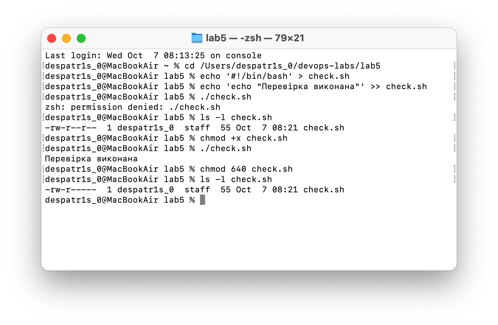
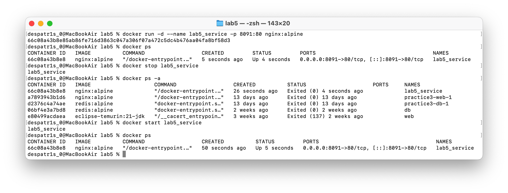
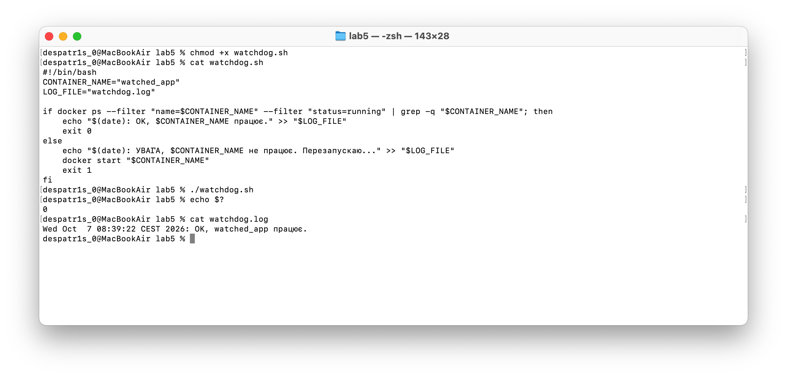
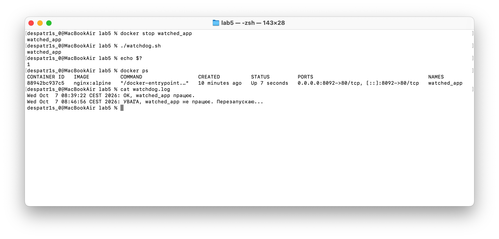

# Практична робота №5. Права доступу та bash-скрипт-сторож сервісу

Дисципліна: «Вступ до DevOps». Варіант 1 (nginx:alpine). Оточення: macOS, Docker Desktop.

## Зміст

1. [Структура репозиторію](#структура-репозиторію)
2. [Частина 1. Права доступу](#частина-1-права-доступу)
3. [Частина 2. Керування сервісом](#частина-2-керування-сервісом)
4. [Частина 3. Скрипт-сторож](#частина-3-скрипт-сторож)
5. [Відповіді на запитання](#відповіді-на-запитання)

## Структура репозиторію

- `check.sh` — скрипт для вправи з chmod
- `watchdog.sh` — скрипт-сторож, що перевіряє й перезапускає контейнер
- `watchdog.log` — лог роботи сторожа
- `screenshots/` — скріншоти виконання

## Частина 1. Права доступу

Запуск `./check.sh` одразу після створення завершився помилкою `permission denied`, бо в файлу не було права виконання (x) ні для власника, ні для групи, ні для інших користувачів. Після `chmod +x check.sh` скрипт запустився, а після `chmod 640 check.sh` права стали `-rw-r-----`.

## Частина 2. Керування сервісом

Оскільки в macOS немає systemd, роль сервісу виконував контейнер `lab5_service` (nginx:alpine). Його статус змінювався Up → Exited → Up командами `docker stop` і `docker start`.

## Частина 3. Скрипт-сторож

Скрипт `watchdog.sh` перевіряє, чи працює контейнер `watched_app`. Якщо так, він пише в лог «OK» і виходить з кодом 0. Якщо ні, він пише попередження, виконує `docker start` і виходить з кодом 1.

Запуск при працюючому контейнері (код виходу 0):

Запуск після `docker stop watched_app` (контейнер перезапущено, код виходу 1):

## Відповіді на запитання

**Що означає число 640 у правах доступу?**
Це вісімковий запис прав: цифра 6 (4+2) дає власнику читання й запис, цифра 4 дає групі лише читання, цифра 0 не дає решті користувачів жодного доступу.

**Чому скрипт перевіряє саме вивід `docker ps` через grep, а не вважає, що контейнер завжди живий?**
Контейнер може зупинитися будь-коли через збій, нестачу ресурсів чи ручне втручання, тож припущення про його «життя» нічого не гарантує. Лише перевірка реального стану через `docker ps` дозволяє скрипту виявити падіння й автоматично перезапустити сервіс.
